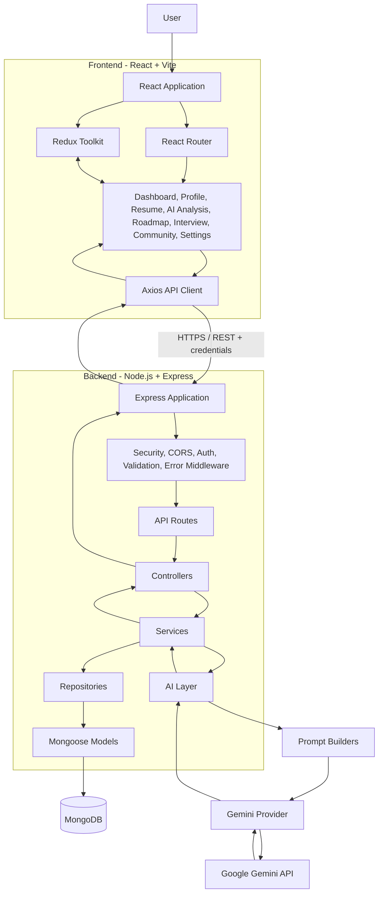
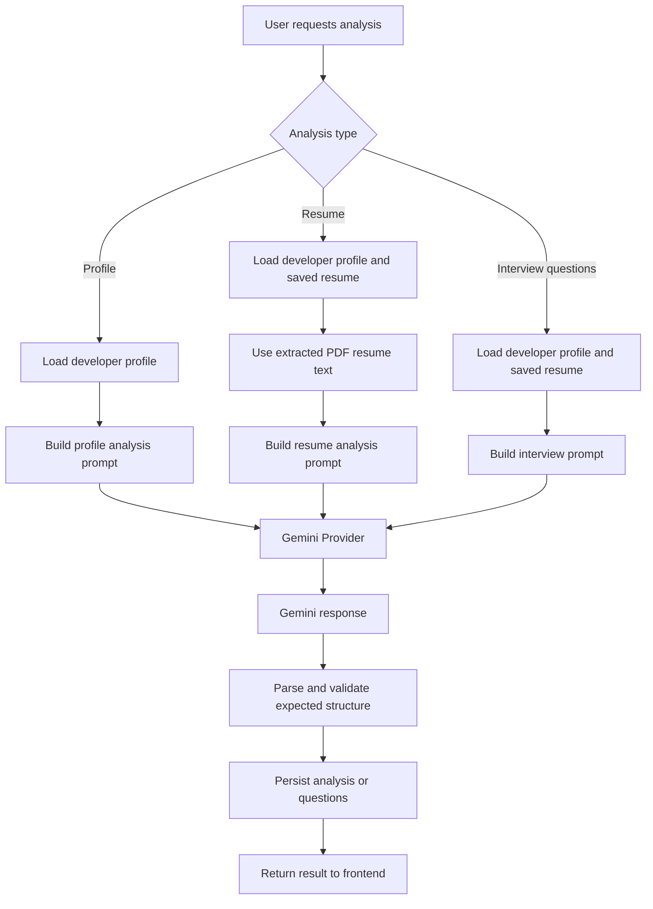

# WebConnect AI

**WebConnect AI** is an AI-powered developer platform that brings together career intelligence, interview preparation, and a developer community in one application.

Users can build a developer profile, receive AI-generated feedback on their engineering readiness, upload and analyze a PDF resume, view a personalized learning roadmap, generate resume-based interview questions, and interact with other developers through posts, comments, and public profiles.

> **Project status:** Active development

## Table of Contents

- [Overview](#overview)
- [Features](#features)
- [Architecture](#architecture)
- [Technology Stack](#technology-stack)
- [Project Structure](#project-structure)
- [Application Flow](#application-flow)
- [Getting Started](#getting-started)
- [Environment Variables](#environment-variables)
- [Running the Application](#running-the-application)
- [API Overview](#api-overview)
- [Authentication and Security](#authentication-and-security)
- [AI Integration](#ai-integration)
- [Data Models](#data-models)
- [Development Commands](#development-commands)
- [Troubleshooting](#troubleshooting)
- [Known Project Notes](#known-project-notes)
- [Contributing](#contributing)
- [License](#license)

---

## Overview

Preparing for software engineering roles often involves using separate tools for profile building, resume feedback, technical interview preparation, and connecting with peers. WebConnect AI brings these activities into a single workspace.

The platform combines a React frontend, an Express REST API, MongoDB persistence, and Google's Gemini model for AI-assisted analysis and question generation.

The backend follows a layered structure:

**Routes → Controllers → Services → Repositories → Models / MongoDB**

AI functionality is separated into prompt builders, a Gemini provider, and response parsers so that prompt construction and model integration do not have to live inside route handlers.

## Features

### 1. Account Management

- User registration and login.
- Password hashing with bcrypt.
- Access-token authentication using JWT.
- Refresh-token handling through an HTTP-only cookie.
- Refresh-token rotation and server-side session revocation.
- Logout from the current session.
- Logout from all devices.
- Session metadata is stored with device and request information.

### 2. Developer Profiles

- Create and update a developer profile.
- Maintain information such as headline, bio, location, current position, experience, skills, interests, and external links.
- Calculate a profile-completion percentage.
- Browse other developers.
- View public developer profiles.

### 3. AI Profile Analysis

WebConnect AI can evaluate a completed developer profile using Gemini.

The generated analysis includes:

- Overall engineering-readiness score.
- Backend, frontend, database, system-design, testing, and DevOps scores.
- Placement-readiness score.
- Identified strengths and weaknesses.
- Actionable recommendations.
- A week-wise learning roadmap.

Profile analyses are saved so that the latest result and analysis history can be retrieved.

### 4. Resume Management and AI Review

- Upload a resume in PDF format.
- Enforce a maximum upload size of 5 MB.
- Extract text from the uploaded PDF using `pdf-parse`.
- Store resume metadata and extracted text.
- Replace or delete an existing resume.
- Generate an AI review using the developer profile and extracted resume content.

The resume analysis returns:

- A profile and resume summary.
- Identified skills.
- Strengths and weaknesses.
- Missing skills.
- Experience and project summaries.
- Resume-improvement suggestions.
- Interview focus areas.

### 5. Personalized Career Roadmap

The roadmap page displays the roadmap generated as part of the latest saved AI profile analysis. Roadmap items are structured by week and learning goal.

### 6. Interview Preparation

- Generate approximately 15–20 interview questions using the user's profile and extracted resume text.
- Questions are tailored around resume content, projects, listed technical skills, software-engineering fundamentals, system design, and behavioral topics.
- Each generated item contains a question, suggested answer, and category.
- Save and retrieve the latest generated interview question set.

### 7. Developer Community

- Create and view developer posts.
- Open an individual post.
- Delete posts owned by the signed-in user.
- Add comments to posts.
- View comments.
- Delete comments owned by the signed-in user.
- Browse users and developers.
- Open public developer profiles.

### 8. Dashboard and Preferences

- Dashboard view for the latest profile analysis and readiness information.
- Settings for dark/light appearance.
- Compact/comfortable display density.
- Notification preference controls for email, AI-analysis, and comment notifications.

> Notification controls currently represent user preferences in the frontend. They should not be interpreted as proof that an email or push-notification delivery service is configured.

---

## Architecture

### High-level architecture

The application is organized into three main parts: the React client, the Express API, and MongoDB. AI requests are handled by a dedicated backend AI layer that communicates with Gemini.



### Backend request lifecycle

A typical API request follows this sequence:

1. The frontend sends a request through the shared Axios client.
2. Express receives the request and applies configured middleware.
3. The route selects the appropriate controller.
4. The controller delegates application logic to a service.
5. The service performs business logic and calls repositories when database access is needed.
6. Repositories interact with Mongoose models and MongoDB.
7. For AI functionality, the service builds a prompt and calls the Gemini provider. AI response parsers convert model output into application data.
8. The controller returns a standardized API response. Errors are passed to the centralized error middleware.

### AI analysis flow



---

## Technology Stack

| Layer | Technologies |
|---|---|
| Frontend | React 19, Vite |
| UI | Material UI, MUI Icons, Emotion |
| Client-side routing | React Router |
| State management | Redux Toolkit, React Redux |
| HTTP communication | Axios |
| UI motion | Framer Motion |
| Backend runtime | Node.js, ES modules |
| Backend framework | Express 5 |
| Database | MongoDB |
| ODM | Mongoose |
| AI integration | Google Generative AI SDK, Gemini |
| Resume processing | Multer, pdf-parse |
| Authentication | JSON Web Tokens (JWT), bcrypt, cookie-parser |
| Validation | Zod |
| Security and middleware | Helmet, CORS, compression |
| Logging | Pino, pino-http |
| Code quality | ESLint, Prettier |

---

## Project Structure

The repository is divided into `frontend` and `backend`.

```text
WebConnect-AI/
│
├── backend/
│   ├── src/
│   │   ├── ai/
│   │   │   ├── parsers/
│   │   │   │   ├── profileAnalysis.parser.js
│   │   │   │   └── resumeAnalysis.parser.js
│   │   │   ├── prompts/
│   │   │   │   ├── profileAnalyzer.prompt.js
│   │   │   │   ├── resumeAnalyzer.prompt.js
│   │   │   │   └── interview.prompt.js
│   │   │   └── providers/
│   │   │       └── GeminiProvider.js
│   │   │
│   │   ├── config/
│   │   │   ├── db.js
│   │   │   ├── env.js
│   │   │   └── logger.js
│   │   ├── controllers/
│   │   ├── middlewares/
│   │   ├── models/
│   │   ├── repositories/
│   │   ├── routes/
│   │   ├── schemas/
│   │   ├── services/
│   │   ├── utils/
│   │   ├── validators/
│   │   ├── app.js
│   │   └── server.js
│   │
│   ├── uploads/
│   │   └── resumes/
│   ├── .env.example
│   └── package.json
│
├── frontend/
│   ├── src/
│   │   ├── api/
│   │   ├── app/
│   │   ├── components/
│   │   ├── features/
│   │   ├── layouts/
│   │   ├── pages/
│   │   ├── routes/
│   │   ├── services/
│   │   ├── store/
│   │   ├── theme/
│   │   ├── App.jsx
│   │   ├── index.css
│   │   └── main.jsx
│   ├── package.json
│   ├── vite.config.js
│   └── vercel.json
│
├── .gitignore
└── README.md
```

### Important backend directories

| Directory | Responsibility |
|---|---|
| `ai/prompts` | Builds structured prompts for profile analysis, resume analysis, and interview preparation. |
| `ai/providers` | Encapsulates communication with the Gemini API. |
| `ai/parsers` | Parses model responses into application data structures. |
| `config` | Database connection, environment configuration, and logging setup. |
| `controllers` | Handles HTTP requests and responses. |
| `middlewares` | Authentication, resume upload, error handling, and not-found handling. |
| `models` | Mongoose schemas and database models. |
| `repositories` | Database operations separated from business logic. |
| `routes` | REST API route definitions. |
| `schemas` and `validators` | Request validation. |
| `services` | Business logic and orchestration. |
| `utils` | JWT, cookies, hashing, PDF parsing, and API response helpers. |

---

## Application Flow

### New user

1. Register an account.
2. Log in to the application.
3. Complete the developer profile.
4. Run AI profile analysis.
5. Review strengths, weaknesses, category scores, recommendations, and the roadmap.

### Resume review

1. Open the Resume page.
2. Upload a PDF resume (up to 5 MB).
3. The backend extracts text from the PDF.
4. Start resume analysis.
5. Review the generated summary, skills, missing skills, suggestions, and interview focus areas.

### Interview preparation

1. Upload a resume and ensure its text has been extracted.
2. Open the Interview page.
3. Generate interview questions.
4. Review each question with its suggested answer and category.
5. Retrieve the latest saved question set when returning to the page.

### Developer community

1. Complete the developer profile.
2. Browse the developer directory.
3. Open public profiles.
4. Create posts and participate in discussions through comments.

---

## Getting Started

### Prerequisites

Install the following before running the project:

- **Node.js** (use a current LTS release compatible with the installed Vite and backend dependencies).
- **npm** (included with Node.js).
- **MongoDB** database — either a local MongoDB instance or a MongoDB Atlas connection string.
- **Google Gemini API key**.
- **Git**.

### 1. Clone the repository

```bash
git clone https://github.com/SRohithkanna/WebConnect-AI.git
cd WebConnect-AI
```

### 2. Configure the backend

Open a terminal:

```bash
cd backend
npm install
```

Create a `.env` file inside the `backend` directory. Use `.env.example` as the template:

```bash
cp .env.example .env
```

On Windows PowerShell, you can use:

```powershell
Copy-Item .env.example .env
```

Fill in all required values. The backend validates required environment variables during startup.

### 3. Configure the frontend

Open a second terminal from the repository root:

```bash
cd frontend
npm install
```

The frontend uses the following API URL by default:

```text
http://localhost:5000/api/v1
```

To point it to another backend, create `frontend/.env` and set:

```env
VITE_API_URL=http://localhost:5000/api/v1
```

For a deployed frontend, set `VITE_API_URL` to the deployed backend's API base URL. Rebuild the frontend after changing Vite environment variables.

---

## Environment Variables

Configure these variables in `backend/.env`:

| Variable | Description | Example |
|---|---|---|
| `NODE_ENV` | Runtime environment | `development` |
| `PORT` | Backend server port | `5000` |
| `CLIENT_URL` | Frontend origin allowed by CORS | `http://localhost:5173` |
| `MONGODB_URI` | MongoDB connection string | `mongodb://127.0.0.1:27017/webconnect_ai` |
| `JWT_ACCESS_SECRET` | Secret used to sign access tokens | Generate a long random secret |
| `JWT_REFRESH_SECRET` | Secret used to sign refresh tokens | Generate a different long random secret |
| `ACCESS_TOKEN_EXPIRES_IN` | Access-token lifetime | `15m` |
| `REFRESH_TOKEN_EXPIRES_IN` | Refresh-token lifetime | `7d` |
| `GEMINI_API_KEY` | Google Gemini API key | Your Gemini API key |

Example configuration:

```env
NODE_ENV=development
PORT=5000
CLIENT_URL=http://localhost:5173

MONGODB_URI=mongodb://127.0.0.1:27017/webconnect_ai

JWT_ACCESS_SECRET=replace_with_a_long_random_secret
JWT_REFRESH_SECRET=replace_with_a_different_long_random_secret

ACCESS_TOKEN_EXPIRES_IN=15m
REFRESH_TOKEN_EXPIRES_IN=7d

GEMINI_API_KEY=your_gemini_api_key
```

**Important:**

- The example above is for local development. Use your own secrets and API key.
- Never commit `.env` files or expose API keys in frontend code.
- Use different values for `JWT_ACCESS_SECRET` and `JWT_REFRESH_SECRET`.
- Configure `CLIENT_URL` to match the actual frontend origin, including the correct protocol and port.
- The backend currently requires `GEMINI_API_KEY` at startup.

---

## Running the Application

Run the backend and frontend in separate terminals.

### Terminal 1 — Backend

```bash
cd backend
npm run dev
```

The backend listens on the configured port. With the default configuration:

```text
http://localhost:5000
```

Health endpoint:

```text
http://localhost:5000/api/v1/health
```

### Terminal 2 — Frontend

```bash
cd frontend
npm run dev
```

Vite normally serves the local frontend at:

```text
http://localhost:5173
```

Open that URL in your browser.

### Production build

Build the frontend:

```bash
cd frontend
npm run build
```

Preview the production build locally:

```bash
npm run preview
```

Start the backend in production mode:

```bash
cd backend
npm start
```

---

## API Overview

The backend API is versioned under:

```text
/api/v1
```

The following route groups are mounted by the Express application.

| Module | Base path | Main operations |
|---|---|---|
| Health | `/health` | API health check |
| Authentication | `/auth` | Register, login, refresh, logout, logout all devices |
| Profiles | `/profile` | Get/update own profile, list developers, public profile |
| AI profile analysis | `/ai` | Generate analysis, get latest analysis, get analysis history |
| Posts and comments | `/posts` | Create/list/get/delete posts, create/list/delete comments |
| Resume | `/resume` | Upload/get/delete resume, analyze resume, get resume analysis |
| Users | `/users` | List users, get a user profile |
| Interview | `/interview` | Generate and retrieve interview questions |

### Selected endpoints

| Method | Endpoint | Purpose |
|---|---|---|
| GET | `/health` | Check API status |
| POST | `/auth/register` | Register a user |
| POST | `/auth/login` | Log in |
| POST | `/auth/refresh` | Refresh tokens using the refresh cookie |
| POST | `/auth/logout` | Log out current session |
| POST | `/auth/logout-all` | Revoke all user sessions |
| GET | `/profile/me` | Get current user's profile |
| PATCH | `/profile/me` | Update current user's profile |
| GET | `/profile` | List developers |
| GET | `/profile/:username` | Get a public profile |
| POST | `/ai/profile-analysis` | Generate profile analysis |
| GET | `/ai/profile-analysis` | Get latest profile analysis |
| GET | `/ai/profile-analysis/history` | Get paginated analysis history |
| POST | `/resume/upload` | Upload a PDF resume |
| GET | `/resume` | Get saved resume details |
| DELETE | `/resume` | Delete saved resume |
| POST | `/resume/analyze` | Generate resume analysis |
| GET | `/resume/analysis` | Get saved resume analysis |
| POST | `/interview/generate` | Generate interview questions |
| GET | `/interview` | Get latest interview questions |
| POST | `/posts` | Create a post |
| GET | `/posts` | List posts |
| POST | `/posts/:postId/comments` | Add a comment |
| GET | `/posts/:postId/comments` | Get post comments |

Most profile, AI, resume, post, and interview endpoints require authentication. The public-profile route is available without the authentication middleware in the current route configuration. Refer to the route files for the exact protection and request requirements.

API responses use a shared response helper and centralized error handling.

---

## Authentication and Security

The application implements several security-related mechanisms:

- Passwords are hashed with bcrypt before being stored.
- Access tokens are JWTs sent by the frontend in the `Authorization: Bearer` header.
- Refresh tokens are issued as cookies and are not returned as ordinary response data.
- Refresh tokens are hashed before session records are stored.
- Refresh-token rotation revokes the previous session and creates a new session record.
- Session records support revocation, expiry, and logout from all devices.
- Protected routes use authentication middleware.
- Request validation uses Zod schemas on configured routes.
- Helmet applies HTTP security headers.
- CORS is configured for the frontend origin and credentials.
- The Express application disables the `X-Powered-By` header.
- Centralized error and not-found middleware handle API errors.

For production, deploy behind HTTPS and review cookie settings, CORS origins, secret management, database access rules, and file-storage strategy for the target environment.

---

## AI Integration

Gemini is integrated through a dedicated provider module:

`backend/src/ai/providers/GeminiProvider.js`

Prompt construction is maintained separately:

- `profileAnalyzer.prompt.js`
- `resumeAnalyzer.prompt.js`
- `interview.prompt.js`

The services call the provider with task-specific prompts. Structured output is parsed before being persisted or returned to the client.

### Profile analysis

The profile-analysis prompt requests scores, strengths, weaknesses, recommendations, and a week-based roadmap. The service checks that required profile information is present before making the model request.

### Resume analysis

The resume-analysis service loads the user's profile and saved extracted resume text, then requests a structured review. It explicitly instructs the model to rely on the supplied profile and resume rather than inventing skills or experience.

### Interview generation

The interview service builds a prompt from the profile and extracted resume text. It requests a set of non-duplicate questions with concise suggested answers and one of the supported categories: Resume, Project, Technical, System Design, or Behavioral.

AI output is model-generated and should be reviewed by the user. Scores and suggestions are guidance, not a formal hiring assessment.

---

## Data Models

The backend uses Mongoose models for persistence. The main models include:

| Model | Purpose |
|---|---|
| `User` | Account credentials and developer profile information |
| `Session` | Refresh-token session hash, device metadata, expiry, and revocation state |
| `ProfileAnalysis` | Saved profile scores, strengths, weaknesses, recommendations, and roadmap |
| `Resume` | Resume file metadata, extracted text, and saved AI analysis |
| `Interview` | Generated interview question sets |
| `Post` | Developer community posts |
| `Comment` | Comments associated with posts |

Repository classes encapsulate persistence operations and are used by services rather than having business logic query models directly.

---

## Development Commands

### Backend

Run these commands from `backend/`:

| Command | Description |
|---|---|
| `npm run dev` | Start the backend with nodemon |
| `npm start` | Start the backend with Node.js |
| `npm run lint` | Run ESLint |
| `npm run lint:fix` | Run ESLint and apply automatic fixes |
| `npm run format` | Format backend files with Prettier |
| `npm run format:check` | Check Prettier formatting |

### Frontend

Run these commands from `frontend/`:

| Command | Description |
|---|---|
| `npm run dev` | Start the Vite development server |
| `npm run build` | Create a production build |
| `npm run preview` | Preview the production build |
| `npm run lint` | Run ESLint |

---

## Troubleshooting

### Backend exits with missing environment variables

Make sure `backend/.env` exists and contains every required variable listed in [Environment Variables](#environment-variables). Restart the backend after editing the file.

### MongoDB connection fails

- Confirm that MongoDB is running or that the Atlas cluster is available.
- Verify the `MONGODB_URI`.
- For MongoDB Atlas, check the database user's credentials and the cluster network access/IP allowlist.

### Frontend cannot reach the backend

- Confirm the backend is running on the expected port.
- Check `VITE_API_URL` in `frontend/.env`.
- Ensure `CLIENT_URL` in `backend/.env` exactly matches the frontend origin.
- Restart Vite after changing environment variables.

### Gemini requests fail

- Confirm that `GEMINI_API_KEY` is set correctly.
- Check that the key has access to the Gemini API and that the configured model is available to the account.
- Review backend logs for provider or response-parsing errors.

### Resume upload fails

- Upload a PDF file.
- Keep the file at or below 5 MB.
- Ensure the backend process can write to `backend/uploads/resumes`.
- A PDF with no extractable text cannot be analyzed by the current text-extraction flow.

### Authentication repeatedly redirects or logs out

- Confirm that the frontend is using `withCredentials` and the correct API base URL.
- Check that the refresh cookie can be set and sent between the frontend and backend origins.
- For cross-site production deployments, configure cookie attributes and HTTPS consistently with the deployment domains.

---

## Known Project Notes

- The backend validates `GEMINI_API_KEY` at startup, so AI configuration is required even when only testing non-AI routes.
- Resume files are currently stored on the backend filesystem under `backend/uploads/resumes`. A production deployment with ephemeral instances should use persistent or external object storage.
- The repository includes a Vite starter entry file at `frontend/src/App.jsx`; the application entry point mounted in `frontend/src/main.jsx` imports `frontend/src/app/App.jsx`.
- The notification preference controls are frontend settings; no notification delivery integration is described here.
- The application is under active development. API details and features may evolve.

---

## Contributing

Contributions, bug reports, and suggestions are welcome.

1. Fork the repository.
2. Create a feature branch.
3. Make focused changes and test them locally.
4. Run the relevant lint/build commands.
5. Open a pull request with a clear description of the change.

Please avoid committing secrets, local environment files, dependency folders, or personal resume uploads.

---

## License

This project declares the **MIT License** in the backend package metadata. A repository-level `LICENSE` file should be included if you intend the repository as a whole to be distributed under that license.

---

**Repository:** [SRohithkanna/WebConnect-AI](https://github.com/SRohithkanna/WebConnect-AI)
